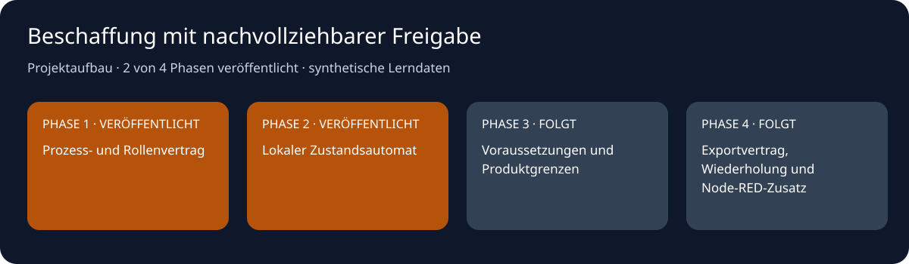

# Beschaffung mit nachvollziehbarer Freigabe

Kleine Beschaffungsanträge sollen mit getrennten Rollen und überprüfbaren Betragsregeln vor einem lokalen ERP-Export freigegeben werden.



**Veröffentlichungsstand: Phase 3/4.** Dieses eigenständige Repository veröffentlicht zuvor lokal entwickelte, geprüfte und unveränderlich gesicherte Stände. Weitere fachliche Phasen werden im Abstand von mindestens vier Stunden veröffentlicht. Die technische Entwicklung und die öffentliche Veröffentlichung haben unterschiedliche echte Zeitpunkte.

## Was hier zu sehen ist

| Schritt | Inhalt | Hier veröffentlicht |
|---|---|---|
| 1 | Prozess- und Rollenvertrag | Ja |
| 2 | Lokaler Zustandsautomat | Ja |
| 3 | Voraussetzungen und Produktgrenzen | Ja |
| 4 | Exportvertrag, Wiederholung und Node-RED-Zusatz | Folgt |

## Fachlicher Nutzen

Prozessmodellierung, Rollentrennung, Validierung, Idempotenz und lokale Workflow-Orchestrierung.

## Lokal starten

Im geklonten Repository ausführen; die benötigte Laufzeit muss installiert sein. Python-Beispiele verwenden 3.12, Node-Beispiele 24 und C# die im Projekt angegebene .NET-Version. Befehle mit uv laden die dort genau bezeichneten Pakete bei Bedarf.

```powershell
node src/prozess.cjs
node nachweise/pruefe_prozess.cjs
```

Ausführliche technische Befehle: [START.md](START.md). [Öffentlicher Prüfstand](ABNAHME.json) und [Quellphasen](VERLAUF.json) dokumentieren Herkunft und echte Ausführungsdaten. Eine neue Repositorykopie ist kein neuer nativer Desktoplauf.

## Demo

Live: <https://jorxas.github.io/beschaffungsprozess-node-red/> (Deutsch, mit Umschalter auf Französisch; `?lang=fr`).

Die Demo zeigt einen Anwendungsfall: einen Beschaffungsantrag freigeben. Der echte Quelltext `src/prozess.cjs` läuft unverändert im Browser (eingebettet durch `demo/erzeugen.cjs`, mit SHA-256 geprüft). Man wählt einen der fünf Beispielanträge oder gibt einen eigenen Betrag ein, führt Aktionen aus (einreichen, genehmigen, ablehnen) und sieht, was der Prozesscode erlaubt oder abweist: Selbstfreigabe, falsche Rolle, Betrag über 500 Euro, fehlendes Budget. Dazu das Änderungsprotokoll, der Gesamtlauf der fünf Beispiele und die echten Ausgaben der Projektskripte (Node 24, Python 3.13).

- Gezeigt wird der veröffentlichte Stand (Phase 2 von 4). Node-RED, Export und Wiederholungsschutz sind darin noch nicht enthalten und werden nicht vorgeführt; Power Automate, SharePoint und SAP werden nicht verwendet.
- Bedarf und Budget gibt in der Demo die bedienende Person an.

Neu erzeugen: `node demo/erzeugen.cjs` (kopiert das Projekt in einen Temporärordner, führt dort die Skripte aus und schreibt `demo/lauf-daten.js` und `demo/prozess-echt.js`). Bauen und prüfen: `node tools/bauen.cjs` und `node tools/browser-pruefen.cjs` (puppeteer-core und Chrome nötig). Veröffentlicht wird der Inhalt von `dist/` auf dem Zweig `gh-pages`.

## Ergebnis des lokal geprüften Schlussstands

Zwei gültige lokale Exporte, Konfliktschutz und unveränderte Wiederholung. Node-RED separat mit echtem Neustart geprüft.

**Dieser Schlussstand ist lokal bereits geprüft, aber noch nicht vollständig in diesem Repository veröffentlicht.** Maßgeblich für den hier verfügbaren Code ist die Phasentabelle oben.

## Grenzen

Power Automate, SharePoint und SAP bleiben unvalidiert. Der eigene JSON-Vertrag ist keine SAP-Schnittstelle. Node-RED bleibt lokal; bekannte npm-Befunde sind im Zusatz dokumentiert.

Eigenes kleines Lernprojekt mit synthetischen Daten, mit KI-Unterstützung entwickelt und geprüft. Keine Aussage über Berufserfahrung, menschliche Arbeitsstunden oder praktische Verwendung weiterer nur geplanter Produkte.

## Entwicklungshistorie

[Entwicklungshistorie](HISTORIE.md): die vorhandenen lokalen Änderungen, ihre ursprünglichen Daten und die spätere GitHub-Übernahme.
